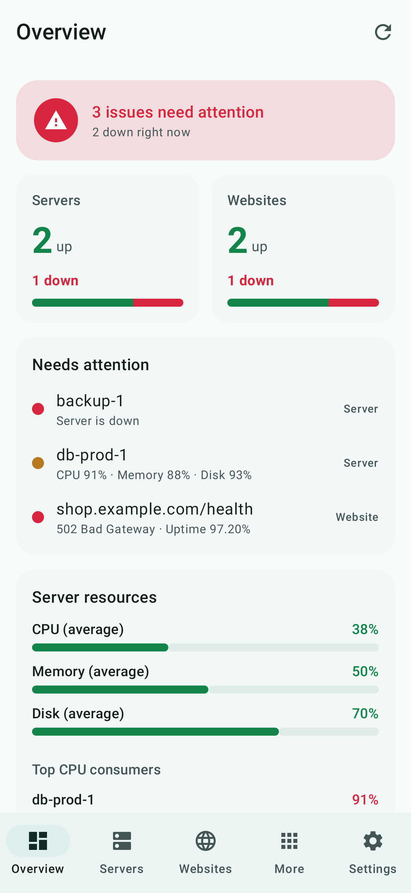
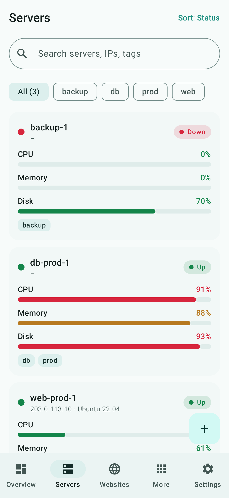
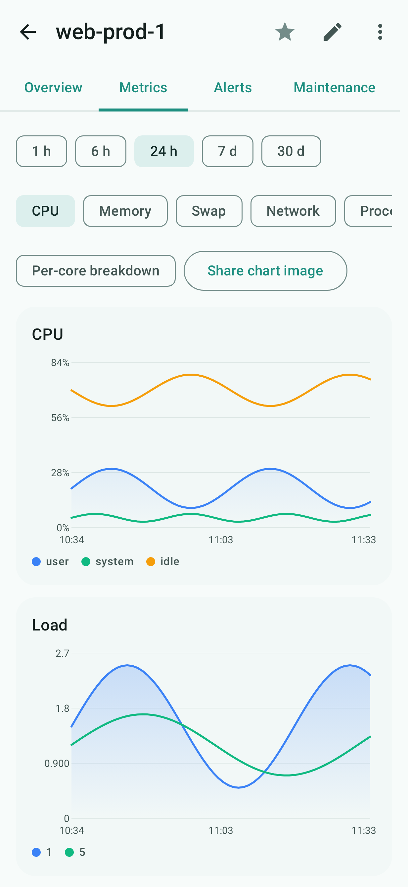
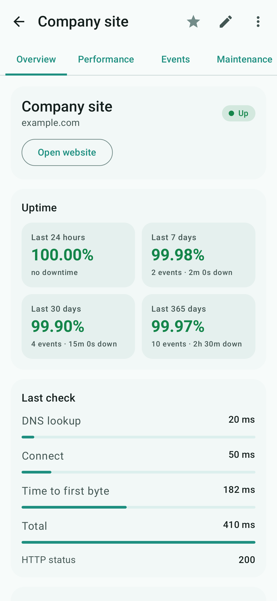
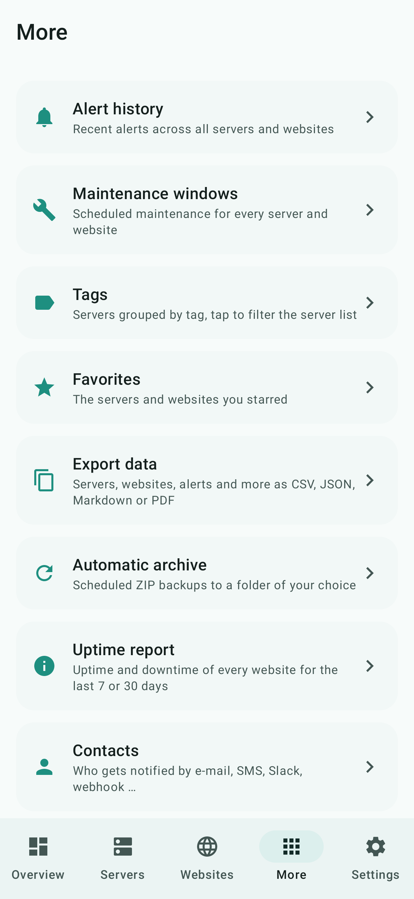
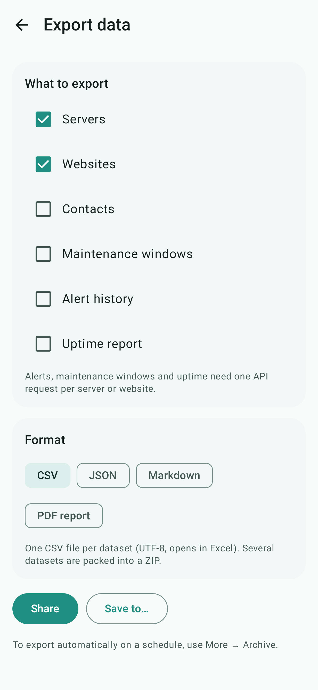
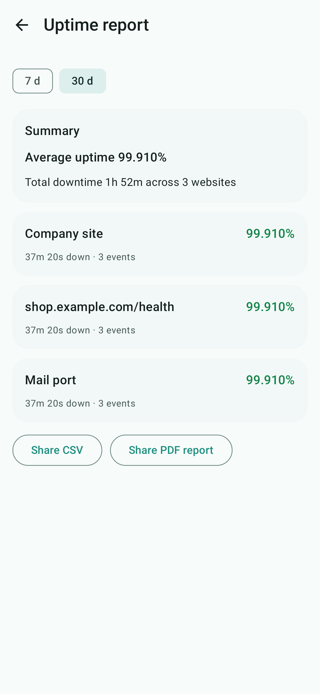
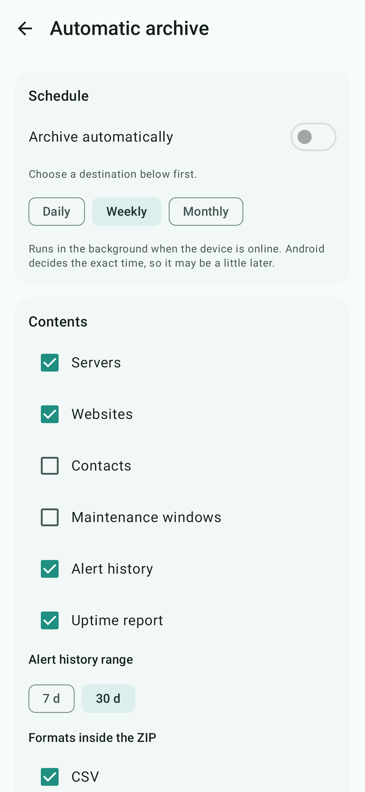
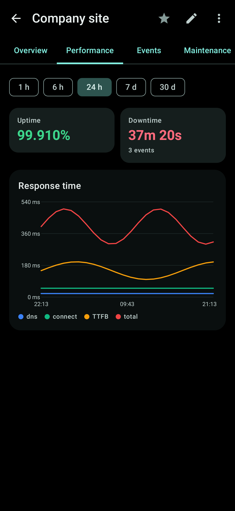
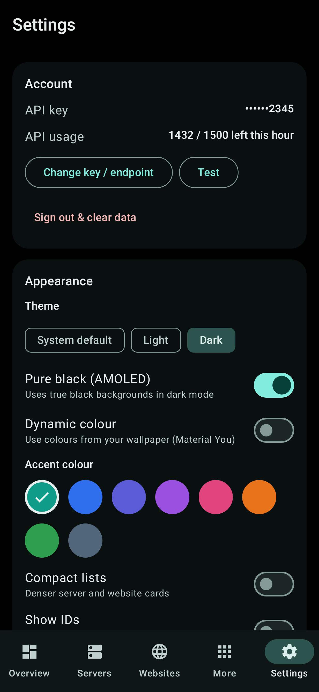

# 360 Monitor

Unofficial Android client for the [360 Monitoring](https://360monitoring.com) API. It shows the state of your servers
and websites, draws their metrics, and lets you add, change and delete website monitors. It has home screen widgets,
background alerts, data export and an Android Auto media app.

| Overview | Servers | Server metrics |
|---|---|---|
|  |  |  |

| Website | More | Export |
|---|---|---|
|  |  |  |

| Uptime report | Automatic archive | Dark theme | Settings |
|---|---|---|---|
|  |  |  |  |

## Install

1. Download the latest APK from the [releases page](https://github.com/mlgtcode/360-monitor-app/releases) (Android 8.0 or newer).
2. Allow your file manager or browser to install unknown apps and open the file.
3. Start the app and enter an API key (360 Monitoring web app: profile menu, *API Keys*; needs a Business or
   Enterprise plan).

## Features

* **Overview:** overall health, everything that needs attention, favorites, average resource usage, slowest websites.
* **Servers:** search, tags, charts for CPU, memory, network, every agent plugin and custom metrics (the dialog
  suggests keys and devices found in the agent data), alert history, maintenance windows.
* **Websites:** add, edit and delete HTTP, HTTPS, TCP and ICMP monitors with all API options, uptime, response times,
  events and maintenance windows. Share a link from the browser to start a new monitor.
* **More:** alert history and maintenance windows for everything, tags, favorites, contacts, status page incidents,
  API user tokens, monitoring locations, diagnostics.
* **Settings:** light, dark and pure black themes, Material You or accent colors, refresh intervals, notifications,
  warning thresholds, About, disclaimer and privacy.
* **Notifications:** a background job (15 minutes to 3 hours) alerts you when something goes down or recovers.

## Widgets

Eight widgets: six status designs (cards, dark, compact, banner, dots, counter) plus scrollable website and server
lists. Each has its own settings (theme, accent, opacity, corner radius, text size, filter) in a configuration screen
with live preview, opened when you add the widget and later through its gear icon.

## Export and archive

* **Export data** (More → Export data): servers, websites, contacts, maintenance windows, alert history and uptime as
  CSV, JSON, Markdown or PDF. Share it or save it with the file picker.
* **Uptime report:** uptime and downtime per website for 7 or 30 days, shareable as CSV or PDF.
* **Automatic archive:** a ZIP with the datasets and formats you choose, daily, weekly or monthly, written to a folder
  you pick. Older archives beyond the number you set are deleted. A folder synced by OneDrive, Google Drive or
  Nextcloud gives you a cloud backup. Contacts include e-mail addresses and phone numbers, so leave them out unless the
  folder is private.

## Android Auto

The app shows up as a media app in Android Auto: browse servers, websites and problems and hear their status. Alerts
are also sent as messaging notifications. For a sideloaded install, enable **Unknown sources** in Android Auto's
developer settings and tick 360 Monitor under *Customize launcher*. Not tested in a car.

## Build

You need JDK 17 or newer and the Android SDK (platform 35, build tools 35) with `sdk.dir` in `local.properties`.

```
./gradlew assembleRelease      # app/build/outputs/apk/release/app-release.apk
```

Without your own keystore the release build is signed with the debug key, which is fine for sideloading. To sign with
your key, set `RELEASE_KEYSTORE` (path), `RELEASE_STORE_PASSWORD`, `RELEASE_KEY_ALIAS` and `RELEASE_KEY_PASSWORD`.

## Disclaimer

This is an independent, unofficial client. It is not affiliated with, endorsed by or sponsored by 360 Monitoring,
WebPros or Plesk. All trademarks belong to their owners.

The software is provided "as is", without warranty of any kind. Use it at your own risk. The author is not liable
for damage, data loss, missed alerts or costs that result from using it. Do not use it as your only monitoring or
alerting channel.

The API key is stored encrypted on your device and is only sent to the API endpoint you configured.
